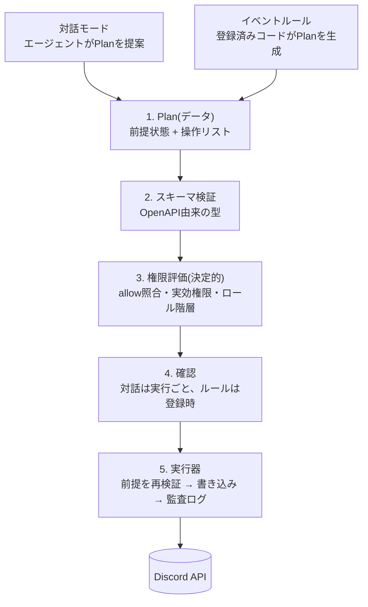
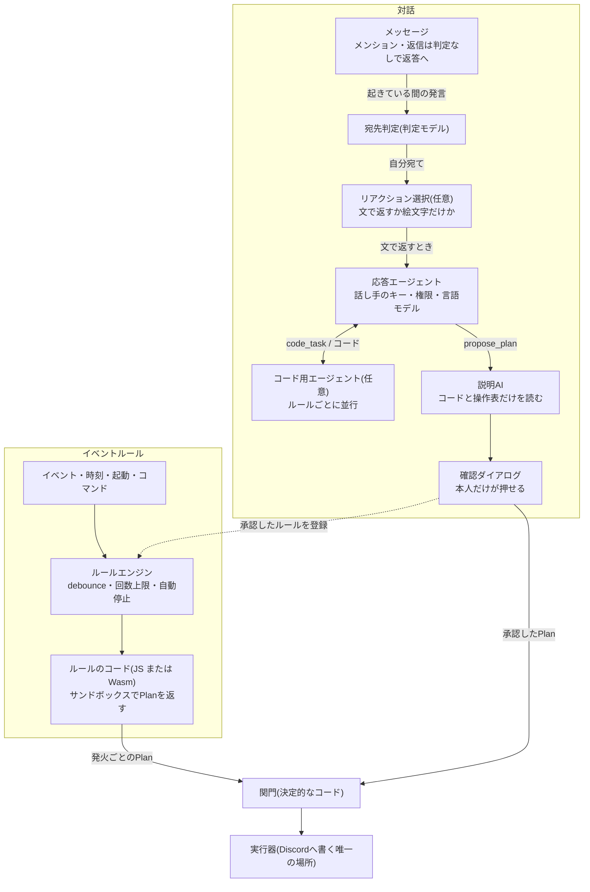
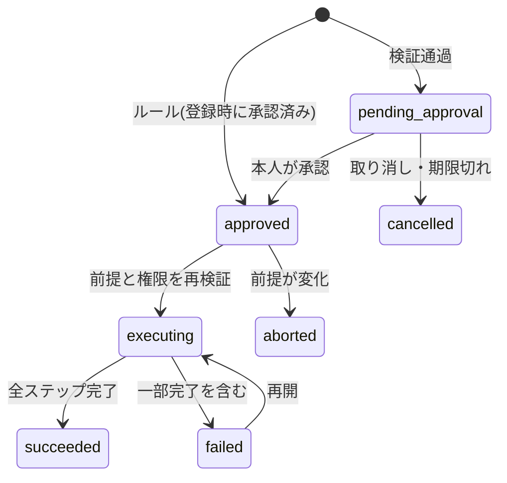

# discord-secretary-bot

内輪のサーバー向けの管理者Discord Botです。メンションして話しかけると、調べもの・サーバーの変更・自動化ルールの作成をしてくれます。

- **Botは Administrator 権限を持つが、書き込みは必ず1つの関門を通す**。関門は決定的なコードで、AIは提案するだけです。
- 読み取りは「そのチャンネルを見られる全員が読める範囲」に絞ります。
- LLMのキーとモデルは各自が `/settings` で登録します(Claude / OpenAI / OpenRouter / GLM Coding Plan / TypeSafe)。

設計の詳細は [設計書](https://claude.ai/artifact/BYS47AdWn4b39C2vpYPZDn) と [詳細仕様](https://claude.ai/artifact/5tXr46YfKP2TzKCeQeHLww) にあります。

## 使い方

| 入口 | できること |
|---|---|
| メンションで会話 | 質問・検索・Web・画像・コード実行。変更が必要なら変更案を出し、本人が承認すると実行 |
| 会話で「〜したら〜して」 | イベントルール(自動化)やギルドコマンドを作る。必要な変更と一緒に1回の承認で登録 |
| `/settings` | APIキー、モデル(言語モデル・判定モデル、応用で用途別の上書き)、Webツール、読み取りを広げる許可 |
| `/settings` の「ルール」 | ルールの一覧・有効化・停止・削除・ドライラン・実行履歴・監査ログ・緊急停止 |
| 会話に `.wasm` を添付 | 自分でビルドした Wasm モジュール(Go・Rust など)をBotと相談しながら登録し、ルールやコマンドのコードとして使う。`/settings` の「Wasm」からも登録でき、一覧・名前変更・削除もそこで([docs/wasm.md](docs/wasm.md)) |

## 全体の仕組み

### 書き込みの関門

どの入口から来た書き込みも、同じ5段を通ります。どの段で失敗しても書き込みは起きません。



### エージェントのつながり

AI同士は直接やりとりせず、会話の文脈・`code_task`・Planというデータだけでつながります。ルールの実行時にLLMは使いません。



| 役割 | モデル | 見るもの・できること |
|---|---|---|
| 宛先判定 | 会話を始めた人の判定モデル(Jev・gpt-6-luna も可) | 自分宛てかと確信度だけを返す |
| リアクション選択 | 話し手のリアクションモデル(任意、なければ判定モデル) | 文で返すか絵文字で済ませるか |
| 応答エージェント | 話し手の言語モデル | 読み取り・検索・Web・画像・`run_code`・`propose_plan`・`widen_read` など |
| コード用エージェント | 話し手のコード用モデル(任意) | `try_code` で試し `submit_code` で提出 |
| 説明AI | Planを作った人の言語モデル | コメントを除いたコードと操作表だけを読んで説明 |
| ルール実行 | なし | 登録済みのコード(事前コンパイルしたJS、またはアップロードされたWasm)を実行し、allowと所有者の権限で検査 |

### Planの状態

承認されたあとも、実行直前に前提と権限を取り直して再検証します。ルールのPlanは登録時の承認で承認待ちを飛ばします。



## 安全のための決まり

- **確認**: 戻せる操作は1クリック。戻せない操作(削除・キック・BAN・多数のDMなど)は対象名の入力が必要です。
- **ルール**: 許す操作(allow)をJSON Schemaで縛ります。Bot自身由来のイベントは既定で無視、1分10回まで、3回続けて失敗で自動停止、全ルールの緊急停止があります。作成者がサーバーを抜けるとその人のルールは止まります。
- **サンドボックス**: コードはすべて Wasm として別スレッドで動きます。JavaScript は WASI 向けにビルドした QuickJS の上で、アップロードされたモジュールはそのまま動き、外へ出る口は `secretary.call` だけです。読み取りとPlanの出力しかできません(1回30秒・メモリ64MiB・`discord.get` 200回まで)。
- **キー**: AES-256-GCM のエンベロープ暗号化で保存し、LLMやログには渡しません。

## 技術構成

Node.js 24+ / TypeScript、pi-ai + pi-agent-core、@discordjs/core + ws、better-sqlite3、TypeBox、QuickJS-ng(WASI ビルド)。HTTPポートは開けず、すべてGatewayで受けます。

```
src/
  agent/     応答・判定・コード用エージェントとツール
  discord/   キャッシュ・実効権限・読み取り範囲・コマンド登録
  llm/       モデル一覧と /settings パネル
  plan/      Planの型・権限対応表(catalog.ts)・検証・確認ダイアログ・実行
  rules/     ルールのきっかけ・allow・エンジン・ルールの管理パネル
  wasm/      Wasm の実行器(worker・WASI・ホスト関数)・アップロードの検査と管理
  sandbox.ts JavaScript を js-runner.wasm で動かす
wasm/js-runner/  JS エンジン(QuickJS)を Wasm にするビルド
examples/wasm/   Go・Rust のモジュールの例
```

## セットアップ

1. Discord Developer Portal でアプリを作り、`SERVER MEMBERS` と `MESSAGE CONTENT` の Intent を有効にする
2. `bot` と `applications.commands` のスコープ、Administrator 権限でサーバーに招待する
3. `.env.example` をもとに環境変数を設定して起動する

| 変数 | 内容 |
|---|---|
| `DISCORD_TOKEN` / `DISCORD_APPLICATION_ID` | Botトークンとアプリケーション ID |
| `DISCORD_GUILD_IDS` | 任意。使うサーバーをカンマ区切りで(空なら全サーバー) |
| `MASTER_KEY` | キー暗号化用の32バイト鍵(`openssl rand -base64 32`)。失うと登録済みキーは復号できない |
| `DB_PATH` | SQLiteのパス(既定 `data/bot.db`) |
| `WEB_SEARCH` | `off` で全員のWebツールを無効にする |

```sh
npm ci
npm start       # 起動時にギルドコマンドを一括登録
npm run check   # 型チェック
npm test        # テスト
```

## 本番と開発

1台で本番(`discord-secretary-bot@prod`)と開発(`@dev`)を systemd で動かし、`deploy/botctl` で操作します。本番に上げられるのは dev で動いているコミットだけで、起動に失敗すると元のコミットとDBに自動で戻ります。

```sh
botctl status | dev [branch] | promote | rollback | logs prod|dev [n] | install
```
